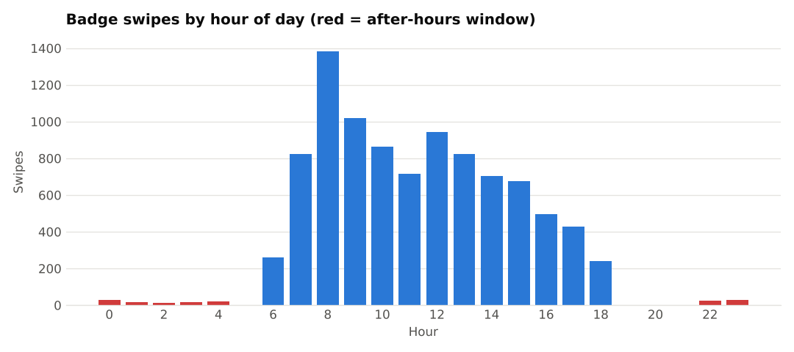
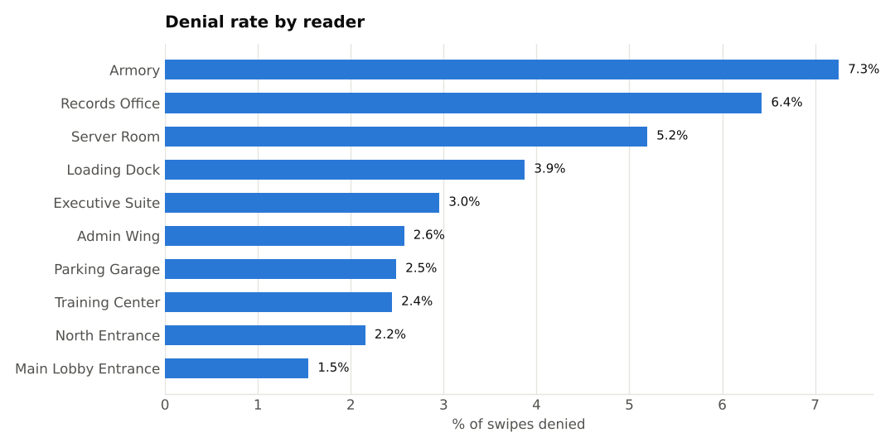
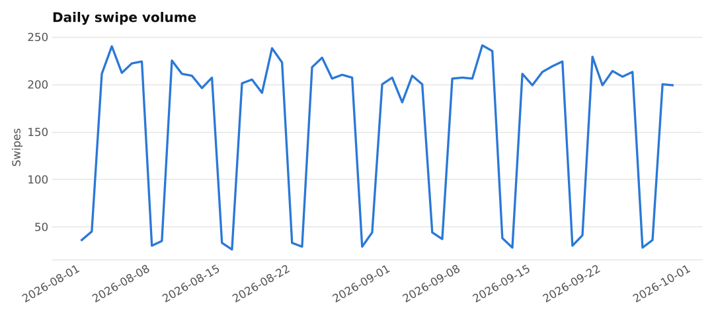
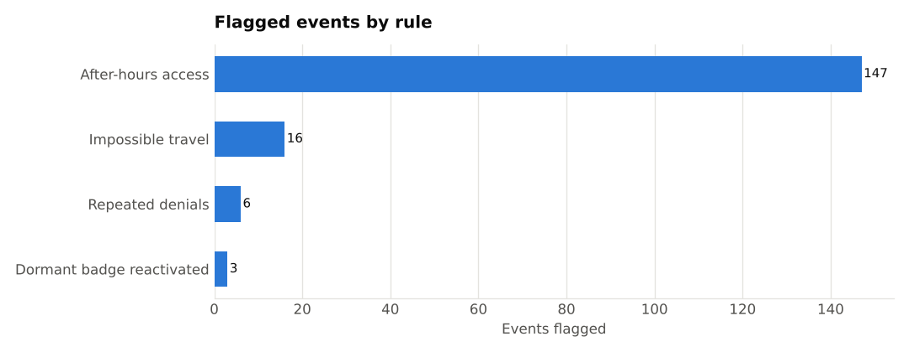

# Badge Access Log Analyzer

A Python data pipeline that ingests physical access-control (badge reader) logs, validates and cleans the data, flags anomalous access patterns with explainable rules, and exports analysis-ready outputs for Excel or Power BI.

## Why this project

In physical security work, access-control logs are often reviewed by hand: scrolling through reader events after an incident, or pulling reports one at a time. This project automates that review. It turns a raw, messy event log into clean data, a ranked list of suspicious activity, and a summary that a non-technical stakeholder can open and filter on their own.

> **All data in this repository is synthetic.** It is generated by `generate_data.py` for a fictional facility. No real people, badges, or locations are used.

## What it does

| Stage | What happens |
|---|---|
| **1. Generate** | Creates ~10,000 realistic reader events across 10 readers, 3 buildings, and 250 badge holders, with intentional data-quality problems and suspicious patterns mixed in |
| **2. Clean & validate** | Trims and standardizes values, removes duplicates, drops rows with missing required fields or malformed timestamps, and logs every fix in a data-quality report |
| **3. Flag anomalies** | Applies four rule-based detections (below), each with a plain-English reason |
| **4. Visualize** | Produces charts for traffic patterns, denial rates, daily volume, and flags |
| **5. Export** | Writes a clean CSV, a flagged-events CSV, and a multi-sheet Excel summary ready for Power BI |

## Anomaly rules

| Rule | Logic | Default threshold |
|---|---|---|
| After-hours access | Granted entry outside normal hours | 10 PM to 5 AM |
| Repeated denials | Same badge denied at the same reader multiple times in a short window | 3+ denials in 10 minutes |
| Impossible travel | Same badge granted at two different buildings faster than a person could move between them | Under 120 seconds |
| Dormant badge reactivated | Badge with no activity for a long stretch, then suddenly active | 30+ days |

Thresholds are constants at the top of `analyze.py` and can be tuned to fit a real facility.

## Sample results

From the default synthetic dataset (seed 42):

- 9,696 raw rows loaded, 9,526 retained after cleaning (98.2%)
- 95 duplicates, 59 rows with missing fields, and 16 malformed timestamps caught and removed
- 172 events flagged across four rules






## Quick start

```bash
git clone https://github.com/cecilboyland-lab/badge-access-analyzer.git
cd badge-access-analyzer
pip install -r requirements.txt

python generate_data.py      # writes data/raw_access_log.csv
python analyze.py            # writes everything to output/
```

Options:

```bash
python generate_data.py --rows 20000 --days 90 --seed 7
python analyze.py --input path/to/your_log.csv --out results
```

## Outputs

| File | Contents |
|---|---|
| `output/clean_access_log.csv` | Validated, de-duplicated event log |
| `output/flagged_events.csv` | Every flagged event with its rule and reason |
| `output/access_summary.xlsx` | Sheets: Data Quality, Flags by Rule, Top Flagged Badges, Reader Summary, All Flags |
| `output/charts/*.png` | Summary charts |

The CSV and Excel outputs load directly into Power BI or Excel for self-service filtering and reporting.

## Project structure

```
badge-access-analyzer/
├── generate_data.py      # synthetic data generator
├── analyze.py            # clean, flag, chart, export
├── DATA_DICTIONARY.md    # field definitions and business rules
├── requirements.txt
├── docs/                 # chart images used in this README
├── data/                 # generated raw data (git-ignored)
└── output/               # analysis outputs (git-ignored)
```

## Possible next steps

- Score badges by combined risk rather than counting flags
- Add a role-based check that flags access to readers outside a badge holder's department
- Build a Power BI dashboard on top of the exported summary
- Load logs into SQLite and query them with SQL

## Tools

Python 3, pandas, matplotlib, openpyxl

## Author

Cecil Boyland Jr.
